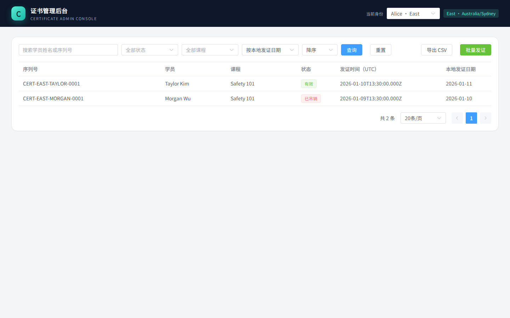
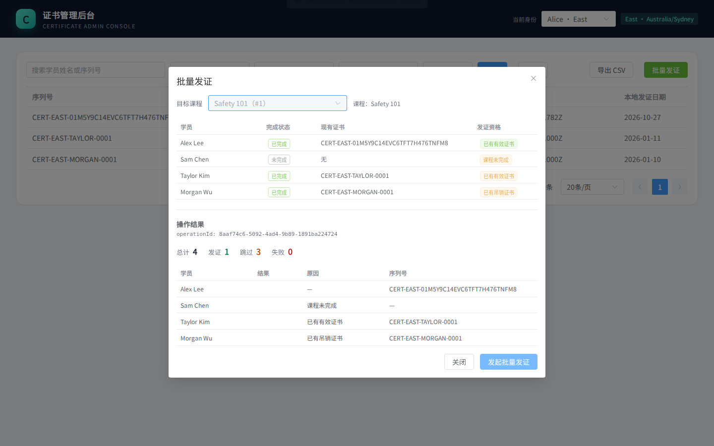
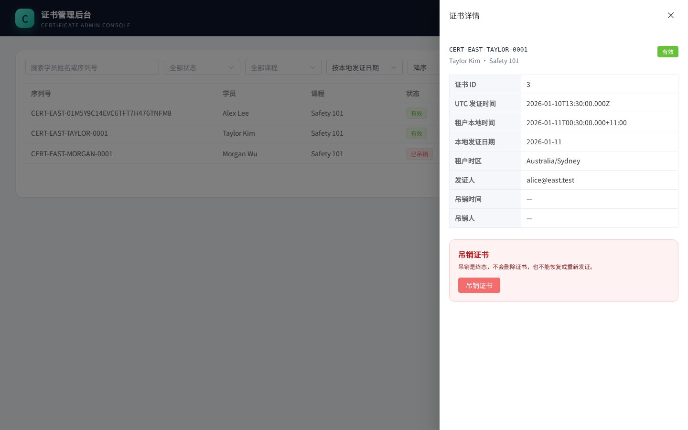

# Certificate Admin Console

多租户证书管理后台，按 `docs/` 中已冻结的架构、数据模型和 API 契约实现。覆盖证书列表、详情、课程批量发证、吊销、CSV 导出，以及 A1–A7 验收场景。

- 后端：Go 1.22.5 + Gin 1.10.0 + SQLite（`modernc.org/sqlite` 1.34.5，纯 Go，无 CGO）
- 前端：Vue 3 + TypeScript + Vite 8 + Element Plus
- 运行形态：单个 Go 进程同时提供 `/api/v1` 和构建后的前端静态文件
- 数据：SQLite WAL，独立写连接 + 多读连接；默认库 `data/demo.db`

## 1. One-command startup（一键启动）

环境要求：**Go 1.22.5+**、**Node.js 20.19+**（实测 24.3.0）、npm。

```bash
git clone https://github.com/WiccyCheng/certificate-admin-console.git
cd certificate-admin-console
./scripts/run.sh
# 打开 http://localhost:8080
```

这一条命令会：

1. 若 `web/node_modules` 不存在，执行 `npm ci`；
2. 构建前端到 `web/dist`；
3. 启动 Go 服务，创建并初始化 `data/demo.db`（仅首次）。

重复启动不会重置已有数据。需要重置演示库时先停止服务：

```bash
rm -rf data/demo.db*
./scripts/run.sh
```

常用变体：

```bash
# 换端口 / 换数据库
ADDR=:8081 ./scripts/run.sh
DB=data/another.db ./scripts/run.sh

# 已有 web/dist，跳过前端构建
SKIP_WEB_BUILD=1 ./scripts/run.sh

# Makefile 等价入口
make run
```

开发模式（前端热更新）：

```bash
# 终端 1
go run ./cmd/server --db data/demo.db --addr :8080

# 终端 2
cd web && npm install && npm run dev   # http://localhost:5173，/api 代理到 :8080
```

### 界面

| 证书列表 | 批量发证与逐学员结果 |
| --- | --- |
|  |  |

| 证书详情（A5 本地时间） |
| --- |
|  |

## 2. Actors, tokens and headers（身份与请求头）

服务端只信 `Authorization` 请求头，tenant 由 token 派生，客户端不能自选租户。

| actor | token | 租户 | 时区 |
| --- | --- | --- | --- |
| alice@east.test | `demo-alice-token` | East | `Australia/Sydney` |
| bob@west.test | `demo-bob-token` | West | `Australia/Perth` |

```bash
BASE=http://localhost:8080
ALICE='Authorization: Bearer demo-alice-token'
BOB='Authorization: Bearer demo-bob-token'

curl -s "$BASE/api/v1/me" -H "$ALICE"
# {"admin":{"id":1,"email":"alice@east.test"},"tenant":{"id":1,"code":"EAST",...}}

curl -s "$BASE/api/v1/certificates" -H "$ALICE"
curl -s "$BASE/api/v1/certificates" -H "$BOB"
```

- token 区分大小写；缺失、格式错误、未知 token 或多个 `Authorization` 值 → `401`，并带 `WWW-Authenticate: Bearer realm="certificate-admin"`。
- `tenantId` 作为 query/body 字段 → `400`；`X-Tenant-Id` 被忽略，仍按 token 的租户执行。
- 非空 body 必须使用 `Content-Type: application/json`，否则 `415`。
- 批量发证必须带且只能带一个 `Idempotency-Key: [A-Za-z0-9_-]{1,128}`。
- 前端右上角有 actor 切换器；REST 客户端直接使用上面的 Bearer token。

## 3. A1–A7 reproduction steps（复现步骤）

以下步骤默认使用**全新默认库**。先准备干净环境：

```bash
rm -rf data/demo.db*
./scripts/run.sh
# 另开终端，设置：
BASE=http://localhost:8080
ALICE='Authorization: Bearer demo-alice-token'
BOB='Authorization: Bearer demo-bob-token'
```

建议顺序：A1 → A2 → A3 → A4 → A5 → A7。A2 会给 Alex 发证，A7 会吊销 Taylor，二者不冲突。A6 使用独立大数据库，最后执行。

### A1 租户隔离

**目标**：East/West 只能看到自己的数据；跨租户路径资源返回 `404`；列表/CSV 过滤不泄露存在性。

```bash
# Alice 只看到 East 的证书 3、4（total=2）
curl -s "$BASE/api/v1/certificates" -H "$ALICE"

# Bob 只看到 West 的证书 1、2（total=2）
curl -s "$BASE/api/v1/certificates" -H "$BOB"

# 跨租户详情 → 404
curl -s -o /dev/null -w '%{http_code}\n' "$BASE/api/v1/certificates/1" -H "$ALICE"
curl -s -o /dev/null -w '%{http_code}\n' "$BASE/api/v1/certificates/3" -H "$BOB"

# 跨租户课程报名 → 404
curl -s -o /dev/null -w '%{http_code}\n' "$BASE/api/v1/courses/3/enrollments" -H "$ALICE"

# 跨租户批量发证 → 404，且不创建证书/审计
curl -s -o /dev/null -w '%{http_code}\n' -X POST "$BASE/api/v1/courses/3/bulk-operations" \
  -H "$ALICE" -H 'Idempotency-Key: a1-cross' -H 'Content-Type: application/json' -d '{}'
curl -s "$BASE/api/v1/certificates" -H "$ALICE"   # 仍是 total=2

# 客户端提交 tenantId → 400
curl -s -o /dev/null -w '%{http_code}\n' "$BASE/api/v1/certificates?tenantId=1" -H "$ALICE"

# X-Tenant-Id 被忽略：仍是 East
curl -s "$BASE/api/v1/certificates" -H "$ALICE" -H 'X-Tenant-Id: 2'

# 跨租户过滤：列表空结果，CSV 仅表头
curl -s "$BASE/api/v1/certificates?courseId=3" -H "$ALICE"
curl -s "$BASE/api/v1/certificates.csv?courseId=3" -H "$ALICE"
```

**UI**：右上角切换 Alice/Bob，列表立即变化；课程筛选只显示当前租户的课程。

### A2 重试安全

**目标**：同一幂等键重试得到同一份已提交结果，不重复发证。

```bash
KEY="a2-$(date +%s)"

# 首次提交 → 201；total=4 issued=1 skipped=3 failed=0，Alex 获得证书
curl -s -o /tmp/a2-first.json -w 'first=%{http_code}\n' \
  -X POST "$BASE/api/v1/courses/1/bulk-operations" \
  -H "$ALICE" -H "Idempotency-Key: $KEY" -H 'Content-Type: application/json' -d '{}'

# 同键同课程重放 → 200；响应字节与首次完全一致
curl -s -o /tmp/a2-replay.json -w 'replay=%{http_code}\n' \
  -X POST "$BASE/api/v1/courses/1/bulk-operations" \
  -H "$ALICE" -H "Idempotency-Key: $KEY" -H 'Content-Type: application/json' -d '{}'
cmp /tmp/a2-first.json /tmp/a2-replay.json && echo 'identical replay'

# East 证书数从 2 变 3，不会重复发证
curl -s "$BASE/api/v1/certificates" -H "$ALICE"
```

**UI**：批量发证 → 选 `Safety 101` → 提交；关闭前网络失败时点“使用同一幂等键重试”，不要换键。

自动化并发验证：

```bash
go test ./internal/httpapi -run TestBulkConcurrentSameKeyA2 -v
```

### A3 键误用

**目标**：同一幂等键用于不同课程返回 `409`，不执行第二次操作。

```bash
# 复用 A2 的 KEY；如果换了终端，请把 KEY 设为 A2 使用的值
curl -s -o /tmp/a3.json -w 'conflict=%{http_code}\n' \
  -X POST "$BASE/api/v1/courses/2/bulk-operations" \
  -H "$ALICE" -H "Idempotency-Key: $KEY" -H 'Content-Type: application/json' -d '{}'
cat /tmp/a3.json   # error.code = IDEMPOTENCY_CONFLICT

# body 语法错误即使键已存在也先返回 400
curl -s -o /dev/null -w 'bad-body=%{http_code}\n' \
  -X POST "$BASE/api/v1/courses/1/bulk-operations" \
  -H "$ALICE" -H "Idempotency-Key: $KEY" -H 'Content-Type: application/json' -d '{"tenantId":1}'
```

预期：`409`，课程 2 的 Alex 仍然没有证书；`400` 不改变已有结果。

### A4 学员结果

**目标**：批量响应按 `learnerId ASC` 返回全部报名，并给出 `issued` / `skipped` / `failed` 及原因。

A2 的响应应包含：

| learnerId | 学员 | status | reasonCode |
| --- | --- | --- | --- |
| 1 | Alex Lee | `issued` | `null` |
| 2 | Sam Chen | `skipped` | `COURSE_INCOMPLETE` |
| 3 | Taylor Kim | `skipped` | `ALREADY_CERTIFIED` |
| 4 | Morgan Wu | `skipped` | `CERTIFICATE_REVOKED` |

```bash
curl -s "$BASE/api/v1/courses/1/enrollments" -H "$ALICE"
```

在 A2 执行前，报名列表的 `issuanceEligibility` 可展示四种资格：可发证、课程未完成、已有有效证书、已有吊销证书。按本节推荐顺序在 A2 后查询时，Alex 已获证，不再出现“可发证”。计数不变量：`total = results.length = issued + skipped + failed`。

### A5 DST 与本地日期

**目标**：UTC 事实按租户 IANA 时区派生本地日期/时间，不写死偏移、不使用浏览器时区。

```bash
# East Taylor：issued_at=2026-01-10T13:30:00.000Z
curl -s "$BASE/api/v1/certificates/3" -H "$ALICE"
# issuedLocalAt = 2026-01-11T00:30:00.000+11:00
# issuedLocalDate = 2026-01-11
# timezone = Australia/Sydney

# West Taylor：同一 UTC 时刻
curl -s "$BASE/api/v1/certificates/1" -H "$BOB"
# issuedLocalAt = 2026-01-10T21:30:00.000+08:00
# issuedLocalDate = 2026-01-10
# timezone = Australia/Perth

# 按本地日期升序：Morgan（01-10, id=4）→ Taylor（01-11, id=3）
# 如果先执行了 A2，Alex 的当天证书会排在最后。
curl -s "$BASE/api/v1/certificates?sortBy=issuedLocalDate&sortOrder=asc" -H "$ALICE"
```

**UI**：点击 Taylor 行打开详情抽屉，查看“租户本地时间”和“租户时区”。

### A6 导出增长（100,000 行）

完整生成/启动命令见下一节。启动大库后，在新终端设置地址：

```bash
BASE_LARGE=http://localhost:8081
```

核心验收：

```bash
time curl -s -o /tmp/certificates.csv \
  "$BASE_LARGE/api/v1/certificates.csv?sortBy=issuedLocalDate&sortOrder=desc" -H "$ALICE"
wc -l /tmp/certificates.csv        # 100001
head -1 /tmp/certificates.csv      # learnerName,courseTitle,serialNumber,issuedLocalDate
```

预期：`200`，约 0.4s（本环境），100,001 行（表头 + 100,000 张 East 证书）；两次导出 SHA-256 相同；导出期间列表仍返回 `200`。

### A7 吊销与审计

**目标**：首次吊销 `201` 并写一条审计；重复/并发吊销 `200`，不新增审计、不改变第一次时间和操作者。

```bash
# 首次 ACTIVE → REVOKED → 201
curl -s -o /tmp/rev1.json -w 'first=%{http_code}\n' \
  -X PUT "$BASE/api/v1/certificates/3/revocation" \
  -H "$ALICE" -H 'Content-Type: application/json' -d '{}'

# 重复吊销 → 200，revokedAt/revokedBy 与第一次相同
curl -s -o /tmp/rev2.json -w 'repeat=%{http_code}\n' \
  -X PUT "$BASE/api/v1/certificates/3/revocation" -H "$ALICE"
cmp /tmp/rev1.json /tmp/rev2.json && echo 'identical revocation'

# 详情：status=REVOKED，发证时间/本地时间不变
curl -s "$BASE/api/v1/certificates/3" -H "$ALICE"

# 跨租户吊销 → 404
curl -s -o /dev/null -w '%{http_code}\n' \
  -X PUT "$BASE/api/v1/certificates/3/revocation" -H "$BOB"
```

审计条数没有查询 API，由自动化测试直接查库断言：

```bash
go test ./internal/httpapi -run TestRevocationA7 -v
```

如果 Taylor 已经是 `REVOKED`（例如重复执行本节），首次请求会返回 `200` 而不是 `201`；要复现 `201` 请重置默认库。

## 4. 100,000-row generation（100,000 行生成）

生成器写入**独立数据库**，不污染 `data/demo.db`；目标文件已存在时拒绝执行。

```bash
# 1) 生成独立大库（约 10s）
rm -f data/large-demo.db* data/large-demo.manifest.json
./scripts/seed-large.sh

# 等价的显式命令：
# go run ./cmd/seed-large --db data/large-demo.db --tenant east --certificates 100000
```

生成内容：

- East 共 **100,000** 张证书（含默认 2 张），West 保持 **2** 张；
- 新增课程 `Export Load`、99,998 位学员、报名、ACTIVE 证书和 ISSUED 审计；
- 姓名 `Load Learner 000`–`Load Learner 099`，序列号 `EAST-LOAD-000001`–`EAST-LOAD-099998`；
- 发证 UTC 时间 `2026-01-01T13:30:00.000Z + (i % 30) 天`，共 30 个本地日期；
- 输出 `data/large-demo.manifest.json`，并执行 `foreign_key_check`、`integrity_check`、证书/审计一致性检查。

manifest 关键值：

```json
{
  "tableCounts": {
    "learners": 100006,
    "enrollments": 100008,
    "certificates": 100002,
    "audit_events": 100004
  },
  "tenantCertificates": { "EAST": 100000, "WEST": 2 },
  "verified": {
    "exportLoadConsistency": "certs=99998 enrollments=99998 audits=99998 active=99998",
    "foreignKeyCheck": "ok",
    "integrityCheck": "ok",
    "targetCertificateCount": "ok"
  }
}
```

启动大库服务（另一个端口，避免覆盖默认库）：

```bash
ADDR=:8081 DB=data/large-demo.db ./scripts/run.sh
BASE_LARGE=http://localhost:8081
```

A6 实测命令：

```bash
# 完整导出 + 计时
time curl -s -o /tmp/certificates.csv \
  "$BASE_LARGE/api/v1/certificates.csv?sortBy=issuedLocalDate&sortOrder=desc" -H "$ALICE"
wc -l /tmp/certificates.csv
head -1 /tmp/certificates.csv

# 再导出一份，比对一致性
time curl -s -o /tmp/certificates-2.csv \
  "$BASE_LARGE/api/v1/certificates.csv?sortBy=issuedLocalDate&sortOrder=desc" -H "$ALICE"
sha256sum /tmp/certificates.csv /tmp/certificates-2.csv

# 固定搜索：姓名匹配 1,000 行，序列号精确 1 行
curl -s -o /tmp/learner007.csv \
  "$BASE_LARGE/api/v1/certificates.csv?q=Load%20Learner%20007&sortBy=serialNumber&sortOrder=asc" -H "$ALICE"
wc -l /tmp/learner007.csv        # 1001
head -2 /tmp/learner007.csv

# 导出期间列表仍可读
curl -s -o /tmp/export-during.csv "$BASE_LARGE/api/v1/certificates.csv" -H "$ALICE" &
curl -s -o /dev/null -w 'list=%{http_code} %{time_total}s\n' \
  "$BASE_LARGE/api/v1/certificates?page=1&pageSize=20" -H "$ALICE"
wait

# West 仍只有 2 张
curl -s "$BASE_LARGE/api/v1/certificates?pageSize=1" -H "$BOB"
```

本环境实测（2026-10-27，WSL2 / Go 1.22.5 / Node 24.3.0）：

- 生成耗时 **9.83s**，峰值内存约 114MB；
- 完整导出 **0.397s**，5,800,049 字节，100,001 行；
- 两次导出 SHA-256 相同；
- 筛选 `Load Learner 007`：1,000 行，0.051s；
- 导出期间列表请求：`200`，0.034s。

中途读取错误（A6 的“截断下载必须失败”）通过测试注入：

```bash
go test ./internal/httpapi -run TestCSVAbortOnMidStreamError -v
```

## 5. 自动化验证与 A1–A7 对照

```bash
./scripts/verify.sh
# gofmt 检查 + go vet + go test -race ./... + 前端 TypeScript 检查/构建
```

| 场景 | 测试 | 覆盖点 |
| --- | --- | --- |
| A1 租户隔离 | `TestTenantIsolationA1` | 跨租户 404、列表/CSV 空结果、`tenantId` 400、`X-Tenant-Id` 忽略、跨租户 bulk 无副作用 |
| A2 重试安全 | `TestBulkIdempotencyA2A3A4`、`TestBulkConcurrentSameKeyA2`、`TestIdempotencyKeyLifecycleAndScope` | 同键同课程 `200` 原样回放；8 并发只发一张证书；失败请求不消耗键 |
| A3 键误用 | `TestBulkIdempotencyA2A3A4` | 同键不同课程 `409`，不覆盖、不二次执行 |
| A4 学员结果 | `TestEnrollmentEligibilityA4`、`TestBulkIdempotencyA2A3A4` | `issued` / `skipped` 及三种原因、`learnerId ASC`、计数不变量 |
| A5 DST 与本地日期 | `TestTimeAndLocalDateA5` | East/West 本地时间、本地日期、默认排序与次排序 |
| A6 导出 | `TestCSVExportA6`、`TestCSVAbortOnMidStreamError` | 四列/CRLF/空结果/筛选/重复导出一致/中途错误中止连接 |
| A7 吊销审计 | `TestRevocationA7` | 首次 `201`、重复与并发 `200`、仅一条 REVOKED 审计、跨租户 404 |

其他已覆盖：`TestValidationRoutingAndHeaders`（400/401/404/405/415、`X-Request-Id`、`Cache-Control`）、`TestCSVFormulaAndQuoting`、`TestMultipleAuthorizationHeaders`。

详细命令与边界见 [docs/verification.md](docs/verification.md)。

## 6. Known defects（已知缺陷）

| # | 缺陷 | 影响 | 规避/说明 |
| --- | --- | --- | --- |
| 1 | 批量发证弹窗关闭后，内存中的 `Idempotency-Key` 丢失 | 关闭会中止请求并作废旧响应，但若请求实际已提交、响应在关闭前未收到（500/503/断网），重新打开弹窗会用新键，可能多一条 `bulk_operations` 记录；证书唯一约束仍防止重复证书 | 在弹窗内使用“使用同一幂等键重试”；不要关闭后重开；刷新列表确认实际结果 |
| 2 | 发证弹窗的报名预览只取前 100 条 | 大课程（如 `Export Load`）预览不完整；提交仍会处理全部报名 | UI 会提示“报名共 N 条，仅展示前 100 条” |
| 3 | CSV 为 UTF-8 无 BOM | Excel 直接打开中文 CSV 可能误判编码 | 程序化消费/验收不受影响；需要 Excel 兼容时可加 BOM，但会改变字节比对 |
| 4 | 前端完整引入 Element Plus | JS 约 1.0MB（gzip 322KB），Vite 报 chunk > 500KB | 首版以功能完整为先；后续可按需引入/代码分割 |
| 5 | 默认库每个租户只有一张 ACTIVE 证书 | 重复跑 A7 后 Taylor 变 REVOKED，再演示“首次 201”会得到 200 | 重置 `data/demo.db*`，或使用新证书/新库 |
| 6 | 演示鉴权是固定 token | 没有登录、token 签发、刷新或真实权限管理 | 题目只要求演示 actor；生产使用需替换认证层 |
| 7 | `failed / ISSUANCE_ERROR` 与 `503` busy 分支缺少端到端触发 | 代码已实现，但默认数据没有自然失败场景；测试未强制耗尽 10s 锁等待 | 已知验证缺口，见下节 |
| 8 | CSV 中途错误测试使用注入的读取错误 | 验证了连接中止语义，但不是物理磁盘故障 | 真实磁盘故障难以稳定复现；测试覆盖了协议行为 |

## 7. Unfinished work（未完成工作）

以下项目**未完成**，其中部分明确不在首版/题目范围内：

- 为 `failed / ISSUANCE_ERROR` 增加可控的 E2E fixture（例如测试专用触发器或注入点），验证单学员失败后继续处理。
- 强制制造 SQLite 锁等待耗尽，端到端验证 `503 + Retry-After`。
- 用真实磁盘/读取故障验证 CSV 中途失败，而不是仅在测试中注入错误。
- 可选接口 `GET /learners`（按姓名找 learnerId）和 `GET /bulk-operations/{operationId}`（刷新后恢复操作详情）未实现。
- 异步批量任务、进度轮询、取消/重试队列未实现（题目未要求，首版为同步）。
- 真实登录、token 签发/刷新、角色管理和密码流程未实现。
- 审计查询 API 未实现；审计已持久化，但只能通过详情/测试/直接查库核对。
- CSV BOM / Excel 兼容选项未实现。
- 前端可访问性（键盘操作、焦点管理）和 Firefox/Safari/移动端人工验证未完成；自动化只覆盖 Chromium headless。
- 第 6 节书面题已随仓库提交：[written-answers.md](written-answers.md)。候选人确认独立完成且未使用 AI，声明见 [ai/completeness.md](ai/completeness.md)。

## 8. API 摘要与数据规则

| 方法 | 路径（省略 `/api/v1`） | 说明 |
| --- | --- | --- |
| GET | `/me` | 当前管理员、租户、时区 |
| GET | `/courses` | 本租户课程选项 |
| GET | `/courses/{courseId}/enrollments` | 课程报名、完成状态、证书、发证资格 |
| GET | `/learners/{learnerId}/enrollments` | 学员各课程报名 |
| GET | `/certificates` | 搜索、筛选、排序、分页 |
| GET | `/certificates/{id}` | 详情（UTC、本地时间、本地日期、发证/吊销人） |
| POST | `/courses/{id}/bulk-operations` | 同步批量发证，必须带 `Idempotency-Key` |
| PUT | `/certificates/{id}/revocation` | 吊销；重复请求幂等 |
| GET | `/certificates.csv` | 流式 CSV，复用列表的筛选与排序 |

完整契约见 [docs/API.md](docs/API.md)，数据模型见 [docs/data-model.md](docs/data-model.md)。

### 关键语义

- **租户隔离**：tenant 只由 token 解析；客户端提交 `tenantId` 返回 `400`，`X-Tenant-Id` 被忽略；跨租户路径资源统一 `404`，列表/CSV 过滤返回空结果。
- **批量发证幂等**：作用域 `tenant + admin + key`。同键同课程返回已存结果（`200`），同键不同课程返回 `409`；首次提交 `201`。并发同键由写事务串行化，只产生一个逻辑结果。
- **吊销**：`ACTIVE → REVOKED` 首次 `201`，重复 `200` 且不新增审计；吊销是终态，本题不重发。
- **时间**：数据库存 UTC `YYYY-MM-DDTHH:mm:ss.SSSZ`；`issuedLocalDate` / `issuedLocalAt` 由租户 IANA 时区派生，不使用浏览器时区；时区数据随二进制嵌入。
- **搜索**：学员姓名或序列号的字面子串，ASCII 不区分大小写，`%` / `_` 为普通字符。
- **CSV**：固定四列、CRLF、UTF-8 无 BOM、公式注入防护；流式写出，中途读取错误会中止连接而不是保存截断文件。

### 序列号规则

| 来源 | 格式 | 示例 |
| --- | --- | --- |
| 在线发证 | `CERT-{TENANT_CODE}-{ULID}`（26 位 Crockford Base32） | `CERT-EAST-01M5Y8QM77F49S7Y0A5T1MC0DX` |
| 默认种子 | `CERT-{TENANT}-{NAME}-0001` | `CERT-EAST-TAYLOR-0001` |
| 大数据生成器 | `{TENANT}-LOAD-{i:06d}` | `EAST-LOAD-000007` |

三类前缀互不冲突；在线序列号时间有序且无需回读。

## 9. 默认演示数据

每个租户 2 门课程、4 位学员、5 条报名、2 张证书、3 条审计；两租户合计 4 门课程、8 位学员、10 条报名、4 张证书、6 条审计。

| 学员 | 课程 | 完成状态 | 初始证书 |
| --- | --- | --- | --- |
| Alex Lee | Safety 101 | COMPLETED | 无 |
| Sam Chen | Safety 101 | INCOMPLETE | 无 |
| Taylor Kim | Safety 101 | COMPLETED | ACTIVE |
| Morgan Wu | Safety 101 | COMPLETED | REVOKED |
| Alex Lee（同一人） | First Aid | COMPLETED | 无 |

Taylor 的 `issued_at` 为 `2026-01-10T13:30:00.000Z`：East 展示 `2026-01-11T00:30:00.000+11:00`，West 展示 `2026-01-10T21:30:00.000+08:00`。

## 10. 项目结构

```text
cmd/server/           Go HTTP 服务入口（API + 静态前端）
cmd/seed-large/       100,000 行大数据生成器
internal/store/       连接池、迁移、默认种子
internal/service/     鉴权、查询、事务发证、吊销、CSV 流
internal/httpapi/     Gin 路由、校验、错误、CSV、集成测试
migrations/           嵌入式 SQL 迁移
web/                  Vue 3 + TypeScript + Element Plus 前端
scripts/              一键运行 / 验证 / 大数据脚本
docs/                 架构、数据模型、API、验收记录
ai/                   AI 会话导出、索引、决策日志、完整性声明
```

## 11. AI 交付记录

相关 OpenCode 与 Codex 规划、环境失败运行、实现、review、前端修复和子代理会话的原生 JSON / JSONL 导出、索引、决策日志及完整性声明均在 [ai/](ai/)。快照边界与导出限制见 [ai/completeness.md](ai/completeness.md)。
