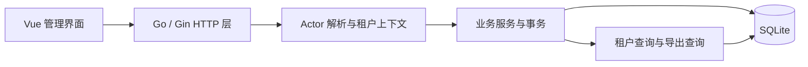

# Certificate Admin Console 架构草案

状态：待讨论，尚未冻结；本轮只规划，不生成应用代码。

依据：`Ocean AI Labs Beijing Technical Interview Assessment - 20261.pdf`，版本 20261026。
本文覆盖产品构建与交付安排，不涉及第 6 节独立书面题的答案。

## 1. 目标与范围

构建一个可本地一键启动的多租户证书管理后台，覆盖证书列表、课程批量发证、详情、吊销、CSV 导出，以及 A1–A7 验收场景。

优先级：核心行为正确 → 可复现验证 → 完整交付材料 → 视觉修饰。

题目要求从空仓库开始，在一次三小时内完成，包括规划、文档和打包。实施时应记录实际起止时间，达到时限后停止实现，并如实说明未完成项。

不扩展生产登录、云部署、通知等题目外功能；本轮也不实现 AI 记录导出。

## 2. 推荐技术栈

| 部分 | 建议 | 原因 |
| --- | --- | --- |
| 后端 | Go + Gin | 满足主流框架约束，路由、中间件、参数校验直接可用 |
| 数据库 | SQLite，WAL 模式 | 本地持久化，无需另起数据库服务 |
| 数据访问 | database/sql + modernc.org/sqlite，显式 SQL | 直接控制租户条件、事务、唯一约束与排序；驱动无需 CGO |
| 前端 | Vue 3 + TypeScript + Vite + Element Plus | 管理后台以表格、分页、选择框和确认弹窗为主，可使用现成组件 |
| 运行形态 | Go 提供 API 和构建后的前端静态文件 | 交付时只有一个服务入口，浏览器同源访问 |
| 验证 | Go 集成测试 + HTTP/浏览器验收 | 重点验证真实 SQLite 上的 A1–A7 |

版本在实施开始时选定并锁定到 go.mod/go.sum、package-lock.json。当前环境是 Go 1.22.5、Node 24.3.0；不能直接假定最新版依赖兼容现有 Go。实现前先明确声明所需 Go 工具链，并验证依赖安装和最小构建。

## 3. 应用结构

采用一个仓库、一个后端进程、一份 SQLite 数据库。后端保持 HTTP → 业务服务 → 显式 SQL 的简单分层，事务由业务服务持有。

建议目录：`cmd/server/`、`internal/httpapi/`、`internal/service/`、`internal/store/`、`migrations/`、`web/`、`scripts/`、`docs/`。不为每张表创建一整套接口和抽象层。

领域模块只包含 Actor/租户上下文、证书查询、批量发证、吊销与审计、CSV 导出。没有独立 worker 服务、消息队列或缓存。

## 4. 数据模型边界

核心实体：

- Tenant：租户及 IANA 时区。
- Admin：演示管理员，每人只绑定一个租户。
- Course、Learner、Enrollment：课程、学员及完成状态。
- Certificate：证书、序列号、UTC 发证时刻、本地发证日期、有效/吊销状态。
- BulkOperation：幂等键、请求指纹、操作 ID、已提交的逐学员结果。
- AuditEvent：实际发证与实际吊销的操作者、证书和时间。

架构层面建议保持以下不变量，字段和参考 DDL 详见后续数据模型草案：

1. 所有租户业务数据具有 tenant_id，关联通过包含 tenant_id 的约束防止串租户。
2. 同一租户、课程、学员最多一张证书，由数据库唯一约束保证。
3. 幂等键在租户和操作者范围内唯一（本表只承载批量发证，不需要类型列）；请求指纹包含课程及全部生效参数。
4. 每次实际发证或吊销对应一条审计，证书变更与审计必须在同一事务提交。
5. BulkOperation 的最终结果和本次成功发证一起提交，不能只把幂等记录放在内存。

数据模型、状态清单及十万条数据生成约定已展开为 [data-model.md](data-model.md)，配套参考 DDL 为 [schema.sql](schema.sql)。同库同表已确认；其余字段、约束、状态语义和生成规则仍待评审。

当前的范围取舍：吊销是终态，本题不增加重新发证流程；吊销后的同一课程/学员再次参与批量发证仍返回 skipped，并说明已有证书。题目没有明确重发规则，该取舍需写入 README；若评审决定允许重发，再调整唯一约束和审计语义。

## 5. 四条关键实现路径

### 租户隔离（A1）

前端选择 Alice 或 Bob，以演示 token/header 标识 actor；后端由 actor 查出可信 tenant_id。业务请求不能通过自报 tenant_id 切换租户。

列表、详情、课程、发证、吊销、导出都必须带服务端租户条件。跨租户资源统一返回不泄露存在性的 404；跨租户发证在写入操作、证书和审计之前拒绝。数据库约束提供第二层保护。

### 批量发证及重试（A2、A3、A4）

首版采用同步请求，前端展示提交中、完成、失败状态和逐学员结果。题目没有要求异步任务系统，因此不持久化 PROCESSING/QUEUED 等执行中状态；只把已提交的操作结果和证书、审计一起落盘，供幂等重放。

1. 确认 actor 对课程的租户访问权。
2. 开启立即取得写权限的事务，查找对应幂等键。
3. 已有同指纹结果则原样回放；已有不同指纹则返回 409，不改原结果。
4. 新操作遍历课程报名：未完成和已有证书返回 skipped 及原因；符合资格才发证。
5. 每位学员的证书和审计作为同一个原子单元；局部可恢复失败用 savepoint 回滚该单元并记录 failed。事务级故障则整体回滚并返回请求失败，不能报告已提交成功。
6. 存储完整操作结果，与所有成功变更一起提交，再向调用者返回。

并发请求由数据库事务与唯一约束收敛到同一个结果。前端禁用重复点击，但服务端正确性不依赖按钮状态。网络重试复用同一键；用户发起新操作才生成新键。SQLite 锁等待和忙碌错误须有明确处理，不把正常并发重试直接变成未处理的 500。

### 时间与吊销（A5、A7）

UTC 时刻是时间事实来源；用租户的 Australia/Sydney 或 Australia/Perth 时区转换，不能写死 UTC 偏移，也不能使用浏览器本地时区代替租户时区。

本题租户时区固定。发证时持久化派生的本地日历日期，用于 SQL 日期排序及 CSV；详情另外展示租户本地时间，保留分钟。普通发证、演示数据和大数据生成器必须复用同一日期转换规则。交付包应包含可用的时区数据。

吊销使用事务内的条件状态更新；只有 ACTIVE → REVOKED 真正发生时才新增审计。重复吊销返回已有状态，不重复记审计。

### CSV 与大数据（A6）

列表与导出共用租户、搜索、排序规则。导出不带列表的分页限制；搜索覆盖学员姓名或序列号。排序字段采用白名单，每种排序都追加唯一证书 ID 作为确定性的次排序条件。

按本地发证日期排序时，主键是本地日历日期，同日按约定的 ID 顺序稳定排列。不能先分页，再在前端换算日期重排。

导出以一条有序查询取得一致的读取视图，逐行写 CSV，内存只保留有限缓冲。保持独立的写入连接和多个读取连接，并限制同时导出的数量，为列表读取预留容量；不能把整个应用限制到单个数据库连接。连接初始化需正确配置 WAL、外键与锁等待。

100,000 行生成器使用显式命令和独立的大数据演示数据库，包含相同排序值及可搜索数据，避免污染默认快速启动数据。验收时实际计时两次导出，比对租户、行数、筛选与顺序，并在导出期间请求列表。60 秒是待实测的验收门槛，不作为未经验证的性能承诺。

## 6. 前端范围

只做一个主页面及必要弹窗/抽屉：

- 顶部：actor 切换及当前租户、时区。
- 主区：搜索、排序、分页、证书表格及 CSV 导出入口。
- 发证弹窗：课程选择、提交状态、逐学员 issued/skipped/failed 及原因。
- 详情抽屉：序列号、课程、学员、本地发证时间、状态和吊销确认。
- 列表及操作均有明确 loading、empty、error 状态。

搜索、分页和排序交给服务端。切换 actor 时清除旧数据和操作状态，取消或忽略旧请求，防止迟到响应显示前一个租户的数据。首版使用 Vue 自身状态管理即可。

## 7. 实施与验收顺序

1. 固定数据/API 语义、依赖版本、启动方式及验收清单。
2. 打通迁移、演示数据、actor 上下文、列表和详情，先验证隔离。
3. 完成事务发证、幂等回放、冲突检测、吊销及审计，验证 A1–A4、A7。
4. 完成前端操作闭环、本地日期和 CSV，验证 A5。
5. 运行独立大数据集，验证 A6 及导出时列表可访问。
6. 从干净环境验证一条启动命令，补齐 README、真实验证结果、已知缺陷和交付材料。

启动命令应安装或使用声明依赖、构建前端、初始化默认演示数据、运行完整应用；重复启动不能重置已有数据。可以另外提供一条验证命令。演示数据必须包含 East/West、指定管理员、两个 Safety 101、两个 Alex Lee，以及已完成、未完成和已发证报名，并包含 A5 指定的 UTC 时刻。

## 8. 与后续 AI 交付工作的接口

实现由用户后续启动的 DeepSeek thread 承担，本会话先讨论方案。建议在细节固定后另写实现交接文档，包含 schema、API 契约、事务步骤、错误语义、A1–A7 检查和完成标准；不让实现线程重新自由选择架构。

用户提到的 `/ai/session`，题目实际要求是仓库内的 `ai/sessions/`，不是 API 路由。本轮只记录边界，后续由用户另启 Agent 编写独立文档并交付：

- `ai/sessions/`：完整原生会话导出，含本次规划、DeepSeek 实现和后续文档/验证会话，保留被拒建议及失败运行。
- `ai/session-index.csv`：每次会话一行，字段为 session_id、tool、model、started_at、ended_at、export_file、purpose、related_commits，统一时区。
- `ai/decision-log.md`：真实的重要决策及对应会话、验证证据和 commit；覆盖接受、拒绝/纠正、范围/设计取舍。不得编造错误或把草案写成已接受决策。
- 原生导出没有记录的命令/编辑应补原始活动日志或等价的完整时间线。
- 完整性声明：列出全部 AI 工具、导出限制及缺失情况；无法导出的工具需完整时序文本；按原要求披露不可导出的自动补全。
- AI 指令文件需保留在 git 中；所有相关会话应从现在开始保留，不能事后用摘要替代完整记录。
- 提交前窄范围脱敏；独立书面题由本人完成，其无 AI 声明应由事实支持。

## 9. 下一轮再定的细节

当前已进入数据模型讨论，详见 [data-model.md](data-model.md)。模型评审后再确定 API 与错误格式、幂等请求规范化、查询与事务实现、启动和验收脚本。

## 参考资料

以下官方文档用于核实框架、驱动及组件能力；具体架构取舍是本草案的建议。

- [Gin 官方文档](https://gin-gonic.com/en/docs/)
- [modernc.org/sqlite：纯 Go 驱动及事务参数](https://pkg.go.dev/modernc.org/sqlite)
- [SQLite WAL：并发读写与读取视图](https://sqlite.org/wal.html)
- [Go time：IANA 时区转换](https://pkg.go.dev/time#LoadLocation)
- [Element Plus 表格与管理界面组件](https://element-plus.org/en-US/component/table.html)
- [Vite 入门与依赖要求](https://vite.dev/guide/)
