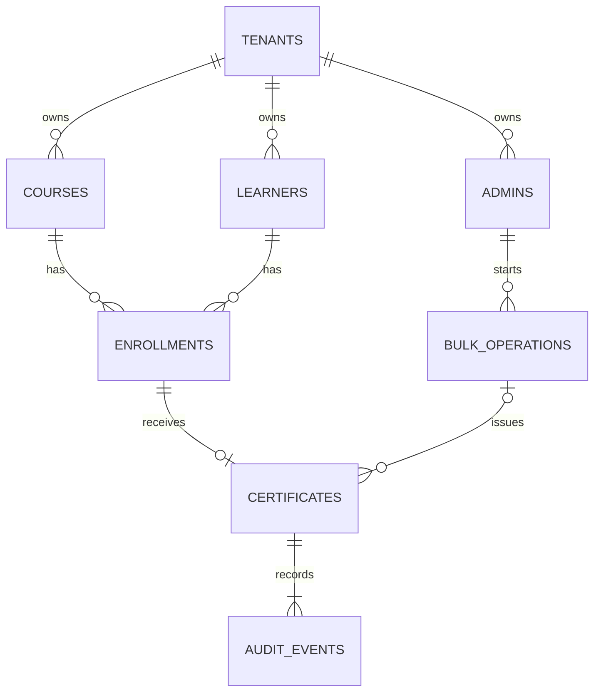

# 数据模型与演示数据约定

状态：已确认并落地。本文的数据模型约定及 [schema.sql](schema.sql) 参考 DDL 已实现为 [migrations/001_init.sql](../migrations/001_init.sql)，接入应用、种子和 100,000 行生成器；业务状态、命名、字段、约束和生成数据规则均已验证。API 契约另见已冻结的 [API.md](API.md)，验收结果见 [verification.md](verification.md)。

## 1. 持久化与租户隔离

业务事实、幂等结果和审计全部保存在 SQLite。服务进程不保留重启后需要恢复的业务状态；请求上下文、连接池、CSV 缓冲和前端 loading 状态不需要落盘。数据库文件必须持久保存，本题采用单机运行，不据此承诺可在多台主机部署共享本地 SQLite 的实例。

采用同库同表（已确认）：两个租户共用 courses、learners 等业务表，使用 tenant_id 区分。

| 选择 | 本题的实现影响 |
| --- | --- |
| 同库同表 | 一套迁移、SQL 和生成逻辑；每条业务查询必须使用可信 tenant_id，复合外键防止跨租户写入 |
| 同库按租户分表 | 需要两套表实例及表名路由，新增租户要建表，迁移/测试/生成器都要覆盖多套表；仍需正确校验 actor 和资源归属 |

共享表是本项目已确认的实现方案，不是 SQLite 自动提供行级访问控制。数据访问层不得暴露无租户条件的业务查询，所有 join 都应保持租户关联；客户端不能用 tenant_id 选择授权范围。

## 2. 命名与类型

| 位置 | 约定 | 示例 |
| --- | --- | --- |
| SQL 表/列 | snake_case，表名复数 | certificates、tenant_id、learner_id、issued_at |
| Go 导出字段 | MixedCaps，ID 保持全大写 | TenantID、LearnerID、CourseID、IssuedAt |
| JSON / TypeScript | camelCase，由 Go JSON tag 映射 | tenantId、learnerId、courseId、issuedAt |
| 枚举值 | 大写字符串，由 CHECK 限定 | COMPLETED、ACTIVE、REVOKED |

SQL/JSON 的写法是项目约定，不存在跨语言唯一强制格式。Go 的 ID 写法遵循官方 initialisms 建议。

- 业务实体主键为 SQLite INTEGER PRIMARY KEY，全库各表内唯一；不依赖跨租户相同 ID。不使用 AUTOINCREMENT，也不提供删除后重用实体的业务流程。
- BulkOperation 的 ID 使用 UUID 字符串，事务处理前可生成，方便证书引用最终操作结果。
- 时间戳统一存 TEXT，UTC 固定格式 `YYYY-MM-DDTHH:mm:ss.SSSZ`；不混用无时区时间、Unix 秒和毫秒。
- 本地日期存 TEXT，格式 `YYYY-MM-DD`；由 Go 使用租户 IANA 时区从 issued_at 派生。展示的本地日期时间由同一转换规则产生。
- 租户时区在此题固定，不提供修改接口；姓名、课程标题也不提供编辑/删除功能。因此证书展示可 join 当前资料，不额外保存姓名/课程快照。
- 所有表采用 STRICT；状态列用 CHECK。SQLite 必须支持 STRICT 与 json_valid。每个连接都要启用 foreign_keys，WAL 和锁等待由连接初始化负责。

你提出的字段对应关系：tenantId 保留；userId 按角色拆成 adminId 和 learnerId；lessonId 改成 courseId，因为题目单位是课程，不需要课时表；orgId 暂不引入，没有租户下组织层级需求；certStatus 使用 certificates.status，避免在多个实体重复维护。

## 3. 实体及字段

共 8 张业务表，迁移工具自身的版本表不计入领域模型。

| 表 | 字段 | 用途 |
| --- | --- | --- |
| tenants | id、code、name、timezone | East/West 与对应时区；code 全局唯一 |
| admins | id、tenant_id、email | 演示 actor；每个管理员只属于一个租户 |
| learners | id、tenant_id、name | 学员；姓名不唯一，两个租户都可以有 Alex Lee |
| courses | id、tenant_id、title | 课程；标题不唯一，不能拿名称当资源 ID |
| enrollments | id、tenant_id、course_id、learner_id、completion_status、completed_at | 学员对某课程的学习事实；一人可报名多课程 |
| certificates | id、tenant_id、enrollment_id、course_id、learner_id、serial_number、status、issued_at、issued_local_date、issued_by_admin_id、revoked_at、revoked_by_admin_id、bulk_operation_id | 证书及发证/吊销信息；bulk_operation_id 对种子数据可为空 |
| bulk_operations | id、tenant_id、actor_admin_id、course_id、idempotency_key、request_hash、request_json、response_json、started_at、completed_at | 已提交的逻辑操作及可原样回放的完整结果 |
| audit_events | id、tenant_id、certificate_id、actor_admin_id、event_type、occurred_at | 每次真实发证和吊销的业务审计 |

不引入通用 users、organizations、roles、lessons、export_jobs、HTTP sessions 表。演示 actor 直接映射 admins；学习者不需要登录。



## 4. 完整状态清单

### 持久化业务状态

| 所属对象 | 状态/事件 | 含义与转换 |
| --- | --- | --- |
| Enrollment.completion_status | INCOMPLETE | 未满足课程完成条件；completed_at 为空 |
| Enrollment.completion_status | COMPLETED | 已完成课程；completed_at 必须非空；证书资格据此判断 |
| Certificate.status | ACTIVE | 证书有效；吊销字段为空 |
| Certificate.status | REVOKED | 已吊销；吊销时间和操作者必须非空；本题不支持恢复或重发 |
| AuditEvent.event_type | ISSUED | 实际发证成功的事实，每张证书恰好一条 |
| AuditEvent.event_type | REVOKED | 实际吊销的事实，每张证书最多一条 |

未发证通过“没有 certificate 行”表达，不存 PENDING 或 NOT_ISSUED 证书。已完成与已发证不能合并：已完成学员可能未发证、持有有效证书或持有吊销证书。

### 每位学员的发证结果

逐学员结果保存在 bulk_operations.response_json 中，状态使用题目要求的小写 issued / skipped / failed。

| 结果 | reasonCode | 含义 |
| --- | --- | --- |
| issued | null | 证书和发证审计均成功，返回 certificateId、serialNumber |
| skipped | COURSE_INCOMPLETE | 课程未完成，没有尝试发证 |
| skipped | ALREADY_CERTIFIED | 已有 ACTIVE 证书 |
| skipped | CERTIFICATE_REVOKED | 已有 REVOKED 证书，当前范围不重新发证 |
| failed | ISSUANCE_ERROR | 本学员发证发生可恢复错误，其证书和审计均回滚；错误详情进入服务日志，不返回原始 SQL 错误 |

按先检查未完成、再检查已有证书的固定顺序判断；正常数据不会同时有“未完成”和“已有证书”。数据库/事务级故障中止并回滚整个请求，不把它伪装成已提交的逐学员失败结果。未知数据库错误默认按事务级故障处理，只有明确可恢复的错误才允许使用 savepoint 后继续。

返回结果固定按 learner_id ASC 排列。response_json 保存 operationId、courseId、total、issued、skipped、failed 计数及 results 数组；每个结果包含 learnerId、learnerName、status、reasonCode、certificateId、serialNumber，计数和结果必须一致。重试直接回放完整已存结果，不根据当前数据重新计算。具体响应结构见 [API.md](API.md)。

### 逻辑操作与前端状态

- BulkOperation 采用同步单事务。数据库对外只有“没有已提交结果”和“已有已提交结果”两种情况；已有记录即 COMPLETED，不再存一个恒为 COMPLETED 的 status 列。
- 对外响应可以带一个派生的 `status: COMPLETED` 字段，便于 UI 显示；它由“已提交操作”这一事实推导，不作为可变状态列落盘。
- 这是有意设计，不是遗漏：题目只要求展示操作状态和逐学员结果，没有要求异步任务、排队、进度恢复或持久化 PROCESSING/QUEUED/RETRYING 状态。真正需要跨重启保留的是证书、审计和已提交的幂等结果；执行中进程崩溃则整个事务回滚，提交后响应丢失则相同键读取已存结果。若未来要做异步任务，才需要额外的状态列、失败收尾和恢复逻辑，本题不引入。
- COMPLETED 表示处理完成，逐学员结果仍可能包含 failed；UI 根据计数显示全部成功、含跳过或存在失败。
- 前端临时状态：idle、submitting、completed、error；列表另有 loading、empty、error。刷新后可用原幂等键恢复操作结果，或重新查询持久化事实。
- 如果需要刷新后仍显示某次操作状态，可增加只读查询并按 operationId 返回已提交结果；这不需要新增状态列，也不在首版必需范围内。
- 导出首版为同步流式 HTTP 下载，不引入导出任务状态；下载完成/失败属于请求状态。
- Tenant、Admin、Course、Learner 不额外增加 enabled、deleted、expired 等题目外状态。

## 5. 约束与事务边界

DDL 包含以下数据库保证：

1. Enrollment 的 `(tenant_id, course_id, learner_id)` 唯一。
2. Certificate 的 `(tenant_id, course_id, learner_id)` 和 `(tenant_id, enrollment_id)` 唯一；serial_number 全局唯一。
3. 证书通过包含 tenant_id、enrollment_id、course_id、learner_id 的复合外键绑定正确报名，防止课程或学员错配。
4. 管理员、课程、学员、证书、操作和审计的关联都包含 tenant_id，拒绝跨租户关系。
5. `(tenant_id, actor_admin_id, idempotency_key)` 唯一；bulk_operations 本表只承载批量发证，不需要额外操作类型列。
6. `(tenant_id, certificate_id, event_type)` 唯一，防止重复发证/吊销审计；状态与吊销字段通过 CHECK 保持一致。

仍需服务层与事务验证的保证：仅已完成报名可发证、每次证书状态变更有对应审计、本地日期换算正确、所有时间戳均为固定 UTC 格式、操作 JSON 与实际变更一致。外键和唯一约束不代替这些业务规则，也不保护遗漏 tenant_id 的读取。

注意：`(tenant_id, course_id, learner_id)` 唯一约束是“吊销为终态、不重发”的实现基础。如果后续允许吊销后重新发证，需要改成只约束 ACTIVE 证书的部分唯一索引，并重新定义审计、幂等结果和列表语义；本题当前不采用该扩展。

在线发证的序列号规则已固定为 `CERT-{TENANT_CODE}-{ULID}`（26 位 Crockford Base32，时间有序），全局唯一且无需回读；种子使用 `CERT-{TENANT}-{NAME}-0001`，large generator 使用 `{TENANT}-LOAD-{i:06d}`，三类前缀互不冲突。规则同时记录在 [README](../README.md)。

发证事务：权限确认 → BEGIN IMMEDIATE → 查询幂等键/比较请求指纹 → 新请求生成 operation UUID → 逐学员发证与审计 → 写入最终 bulk_operations → COMMIT。证书引用操作的外键延迟到提交检查，因此不需要先写一条处理中操作或占位 JSON。同键不同课程返回 409；跨租户课程先返回 404，不创建操作。

request_json 是校验后、规范化的业务请求，不是原始字节；request_hash 为其 SHA-256。当前唯一业务参数是课程，因此规范化请求为 `{"courseId": N}`；后续任何会改变语义的参数必须参与指纹。重放按 tenant_id 和 actor_admin_id 隔离；body 只允许省略/空/`{}`，不承载业务字段，未知字段一律拒绝。规范化规则至少固定 UTF-8 编码、对象键排序、紧凑分隔符、稳定数值表示；idempotency key 必填，作用域为 `tenant_id + actor_admin_id + key`。具体 API 形状见已冻结的 [API.md](API.md)。

首次响应与幂等重放应返回同一份已存结果，避免分别序列化导致结果不一致；可以在事务内生成 response_json，提交后原样返回，重放时也原样返回。

吊销事务：租户内读取 → ACTIVE 才做条件更新 → 写一条 REVOKED 审计 → COMMIT。已 REVOKED 时返回原状态，不新增审计。禁止把 revoked_at 当作发证日期更新。

## 6. 查询与索引

- 列表与导出使用相同租户范围、姓名/序列号搜索及排序规则，导出不受分页限制。CSV 固定导出 learnerName、courseTitle、serialNumber、issuedLocalDate 四列，详见 [API.md](API.md)。
- 列表的 `total` 与当前页 `items` 必须在同一读事务/同一快照内计算；跨页不要求同一快照。
- 建议首版排序字段：learnerName、serialNumber、issuedLocalDate；统一追加 certificate.id ASC 作为次排序，即使主字段 DESC 也不改变该约定。
- 索引至少覆盖证书的 `(tenant_id, issued_local_date, id)`、`(tenant_id, serial_number, id)`、`(tenant_id, learner_id, id)`；学员姓名与课程标题有租户前缀索引。
- `%keyword%` 子串搜索和跨表姓名排序可能扫描/临时排序，不能声称普通索引完全覆盖。十万行的实际查询计划和耗时在实现阶段验证，再决定是否需要优化。
- SQLite 读连接可并发使用，写事务短且串行；CSV 流式读取与连接池容量由后端统一控制。

## 7. 默认演示数据

初次在空库内一次事务完成种子初始化；重复启动不重复初始化、不重置用户操作。默认数据库建议 `data/demo.db`。

两个租户分别为 East / Australia/Sydney、West / Australia/Perth；管理员 alice@east.test、bob@west.test。每租户配置下表：

| 学员 | 课程 | 完成状态 | 初始证书 |
| --- | --- | --- | --- |
| Alex Lee | Safety 101 | COMPLETED | 无，用于实际发证 |
| Sam Chen | Safety 101 | INCOMPLETE | 无，用于 skipped |
| Taylor Kim | Safety 101 | COMPLETED | ACTIVE，用于已发证 skipped 及 A5 |
| Morgan Wu | Safety 101 | COMPLETED | REVOKED，用于终态展示 |
| Alex Lee（同一人） | First Aid | COMPLETED | 无，用于 A3 换课程重用键 |

每租户 2 门课、4 位学员、5 条报名、2 张证书、3 条审计；两租户合计 4 门课、8 位学员、10 条报名、4 张证书、6 条审计，初始 bulk_operations 为空。

Taylor 的 issued_at 均为 `2026-01-10T13:30:00.000Z`：East 的本地日期为 2026-01-11、时间 00:30；West 为 2026-01-10、时间 21:30。Morgan 的 issued_at 为 `2026-01-09T13:30:00.000Z`，revoked_at 为 `2026-01-10T00:00:00.000Z`。

注意：每租户初始只有一张 ACTIVE 证书（Taylor），A7 会将其吊销；若在同一默认库连续运行多个验收场景，README 需说明重置数据库，或先通过批量发证生成新的 ACTIVE 证书。

种子中的每张证书同样有 ISSUED 审计，REVOKED 证书另外有 REVOKED 审计；操作人使用本租户管理员，bulk_operation_id 为空。种子与在线业务共用日期转换和序列号规则，不能造只有证书、没有课程/学员/报名/审计的扁平假数据。默认种子用稳定显式 ID 便于复现；姓名/课程标题不作为唯一标识。

## 8. 十万条生成器约定

此处定义实现契约，暂不编写生成程序。

```text
go run ./cmd/seed-large --db data/large-demo.db --tenant east --certificates 100000
```

- 命令先建 schema 并初始化默认两租户数据，再给 East 补齐至 **总共 100,000 张证书**，其中包含原有 2 张；West 保持 2 张。默认 demo.db 不受影响。
- 输出数据库路径必须显式指定，与默认库相同时拒绝。目标文件已存在时拒绝，避免误覆盖或重复追加；重建使用新的输出路径。
- 新增一门 East 课程 Export Load、99,998 位学员、对应 COMPLETED 报名、ACTIVE 证书及每张一条 ISSUED 审计。不生成批量操作记录，bulk_operation_id 为空。
- 对 i=1..99,998：学员姓名为 `Load Learner {i % 100:03d}`；序列号为 `EAST-LOAD-{i:06d}`。姓名故意重复，序列号全局唯一。
- 发证 UTC 时刻为 `2026-01-01T13:30:00.000Z + (i % 30) 天`；大量相同本地日期和姓名用于稳定排序验收。学员完成时间统一早于最早发证时间。
- 所有 ID、姓名、序列号、时间及插入顺序均确定，不使用当前时间或随机数据；bulk_operation_id 为空，所以无需随机 UUID。相同参数生成的逻辑数据和排序结果一致，不要求数据库文件逐字节相同。
- 以有限大小批次写事务、预编译参数化插入，启用外键，不关闭一致性约束。该命令离线生成，不在运行中的默认库执行。
- 输出同名 manifest JSON，记录数据集版本、参数、各租户/表行数、日期分布、`Load Learner 007` 等固定搜索的预期匹配数，供验证器独立对比。
- 完成后运行 foreign_key_check、integrity_check，以及证书/报名/审计计数一致性检查。`--certificates` 表示目标租户证书总数，不能解释为额外新增行数；小于默认已有数量则报错。

A6 验收使用该库启动服务，对相同搜索和排序导出两次：对照 manifest 的匹配行数、确认全为 East、确认主排序与 ID 次排序、比对两份结果，并在导出期间成功访问列表。另注入一次导出中途读取错误，确认浏览器下载失败而不是保存截断文件。生成耗时不混入 CSV 导出耗时。

## 9. 实施前检查

已确认的参考 DDL 可执行并已用于结构验证；实现阶段已落地为 `migrations/001_init.sql`，并在真实 Go 驱动上验证每连接外键、延迟外键、事务锁与并发幂等，然后接入 UI。数据生成器和业务服务共用模型约束与日期规则。具体结果见 [verification.md](verification.md)。

本轮通过 Python 标准库在临时磁盘数据库、SQLite 3.45.1 上执行了 15 项模型检查，覆盖跨租户关系拒绝、报名/课程错配、重复证书和审计、非法状态、吊销字段一致性、幂等键唯一性、延迟外键提交/回滚、重复条件吊销、重开数据库后结果保留及 A5 的两个时区样例；foreign_key_check 与 integrity_check 均通过。这些是模型级检查，不代表 Go 实现、HTTP 并发、完整 A1–A7 或十万行性能已通过。

参考：[SQLite 外键与延迟检查](https://sqlite.org/foreignkeys.html)、[STRICT 表](https://sqlite.org/stricttables.html)、[Go 缩写命名](https://go.dev/wiki/CodeReviewComments#initialisms)。共享表、命名映射、状态集合和生成器参数是本项目建议。
